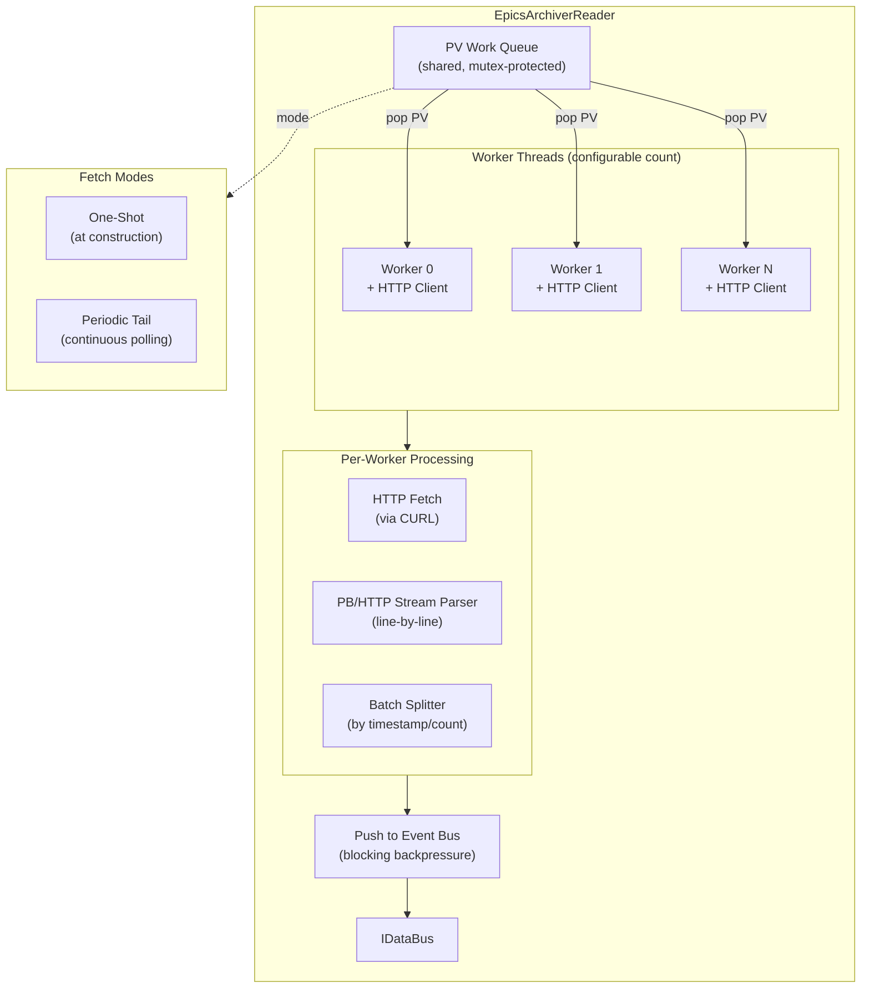

# EpicsArchiverReader (Historical Data Retrieval)

The `EpicsArchiverReader` provides access to historical EPICS data from the EPICS Archiver Appliance. It fetches time-windowed datasets and supports both one-shot historical retrieval and periodic polling modes.

**Registration Type:** `"epics-archiver"`

**Status:** Implemented and actively developed

File           | Location
-------------- | -------------------------------------------------------
Header         | `include/reader/impl/epics_archiver/EpicsArchiverReader.h`
Implementation | `src/reader/impl/epics_archiver/EpicsArchiverReader.cpp`
Config         | `include/reader/impl/epics_archiver/EpicsArchiverReaderConfig.h`

## Build Option & Required Libraries

- **Build option:** none (always built)
- **Required libraries/components:**
  - libcurl (`CURL::libcurl`) for HTTP transport
  - Protobuf (`protobuf::libprotobuf`) + epicsarchiverap protobuf payload definitions
- **Configure-time hints:** standard CMake package discovery for CURL/Protobuf

## Architecture



## Operating Modes

### One-Shot Historical Fetch (Default)

1. EpicsArchiverReader constructed with start/end timestamps
2. Background worker thread starts immediately
3. Initiates HTTP GET request to Archiver Appliance `/retrieval/data/getData.raw`
4. Streams PB/HTTP response (PayloadInfo + ScalarDouble samples)
5. Parses protobuf messages line-by-line
6. Pushes batches to event bus
8. Completes and thread exits (reader still running but idle)
9. Signals `signalCompleted()` to notify the controller — enables [auto-close](readers.md#reader-lifecycle--auto-close) when all readers are one-shot

**Worker thread lifecycle:** Starts, fetches and processes, exits automatically. Calls `signalCompleted()` on exit to support [controller auto-close](readers.md#reader-lifecycle--auto-close). Shutdown cancels the HTTP request immediately; thread joins before destructor completes.

```yaml
reader:
  - epics-archiver:
      - name: my_archiver_reader
        hostname: "archiver.example.org:11200"  # Required
        mode: historical_once               # default; or periodic_tail
        start-date: "2024-01-01T00:00:00Z"  # Required in historical_once (alias: startDate)
        end-date: "2024-01-02T00:00:00Z"    # Optional (alias: endDate)
        connect-timeout-sec: 30             # default 30; must be > 0
        total-timeout-sec: 300              # default 300; 0 = infinite, else >= connect-timeout-sec
        tls-verify-peer: true               # default true
        tls-verify-host: true               # default true; requires tls-verify-peer
        fetch-threads: 4                    # Parallel PV fetch workers (default: 1)
        # pv-samples-per-batch: 1000        # optional; default 0 = disabled, > 0 when set
        batch-flush-interval-ms: 0          # deprecated, no effect (> 0 when set)
        max-batch-span-sec: 86400           # default 86400 (MLDP bucket limit)
        fetch-max-retries: 3                # default 3; retries per failed PV fetch
        fetch-window-sec: 86400             # default 86400; split range into aligned windows, 0 = one request
        fetch-retry-backoff-ms: 1000        # default 1000; delay between retries
        status-log-path: archiver-status-my_archiver_reader.jsonl  # default archiver-status-<name>.jsonl; "" disables
        metadata:                           # optional static metadata for every PV
          source: archiver
        pvs:                                # Required
          - name: EXAMPLE:PV:A
            metadata:                       # optional per-PV metadata
              unit: mm
          - name: EXAMPLE:PV:B
```

### Periodic Tail Mode

1. Configured with `mode: periodic_tail`
2. Background worker thread runs continuously
3. Each iteration: generates time window from `now - lookback` to `now`
4. Fetches archiver data for that window
5. Processes and pushes new events
6. Waits `poll-interval-sec` (interruptible via condition variable)
7. Repeats until reader destruction

**Worker thread lifecycle:** Runs until reader destruction. Condition variable allows prompt shutdown without waiting for poll interval to expire. Does **not** call `signalCompleted()` — periodic readers never trigger [auto-close](readers.md#reader-lifecycle--auto-close).

```yaml
reader:
  - epics-archiver:
      - name: continuous_archiver
        hostname: "archiver.example.org:11200"
        mode: periodic_tail             # Enable continuous polling
        poll-interval-sec: 5            # Required, > 0: poll every 5 seconds
        lookback-sec: 5                 # Optional, default poll-interval-sec; 0 < lookback <= poll-interval
        pvs:
          - name: MY:PV:NAME
```

## Configuration

### Required Parameters

Parameter | Type   | Description
--------- | ------ | ------------------------------------------------------------------
`name`     | string | Reader instance name (non-empty)
`hostname` | string | Archiver Appliance host:port (e.g., `archiver.example.org:11200`)
`pvs`     | list   | Sequence of `{name, metadata?}` maps; `name` required, `metadata` optional string map

### Common Parameters

Parameter         | Type   | Default                      | Description
----------------- | ------ | ---------------------------- | -------------------------------------------------------------------
`mode`            | string | `historical_once`            | `historical_once` or `periodic_tail`
`metadata`        | map    | none                         | Static string map attached to every PV
`pvs[].metadata`  | map    | none                         | Static string map for one PV
`status-log-path` | string | `archiver-status-<name>.jsonl` | Per-PV fetch status log (JSONL); empty string disables it

### One-Shot Mode Parameters

Parameter            | Type   | Default | Description
-------------------- | ------ | ------- | -------------------------------------------------------------------
`start-date`         | string | —       | **Required** ISO 8601 timestamp for query start (alias `startDate`)
`end-date`           | string | —       | ISO 8601 timestamp for query end (alias `endDate`); when omitted no `to` is sent and the Archiver Appliance applies its own default

### Periodic Tail Mode Parameters

Parameter            | Type   | Default         | Description
-------------------- | ------ | --------------- | -----------------------------------------------------------------
`mode`               | string | `historical_once` | Set to `periodic_tail` to enable continuous polling
`poll-interval-sec`  | int    | none (required) | Polling interval in seconds; must be `> 0` in `periodic_tail`
`lookback-sec`       | int    | `poll-interval-sec` | Seconds of history to fetch per poll; `> 0` and `<= poll-interval-sec`

### Parallelism Parameters

Parameter       | Type | Default | Description
--------------- | ---- | ------- | -------------------------------------------------------------------
`fetch-threads` | int  | 1       | Number of parallel worker threads fetching PVs concurrently. Each worker has its own HTTP client. PVs are distributed via a shared work queue — workers pop the next available PV when they finish the current one.

When `fetch-threads > 1`:
- Each worker owns an independent HTTP connection (curl handles are not shared)
- PVs are load-balanced dynamically — slow PVs don't starve fast workers
- Worker HTTP clients use infinite timeout (`total-timeout-sec=0`) and disabled stall detection to avoid false aborts during bus backpressure
- Shutdown sets `running=false` and cancels all HTTP clients; workers exit immediately, dropping any buffered samples

### Sample-Count Batching Parameters

These parameters apply to both `historical_once` and `periodic_tail` modes.

Parameter                 | Type | Default | Description
------------------------- | ---- | ------- | -------------------------------------------------------------------
`pv-samples-per-batch`    | int  | 0       | Flush a pending PV batch after accumulating this many samples. `0` = disabled (submit immediately via timestamp splitting only).
`batch-flush-interval-ms` | int  | 0       | **Deprecated, no effect.** Accepted for compatibility. Partial batches are always submitted when a PV fetch completes.
`max-batch-span-sec`      | int  | 86400   | Flush a pending PV batch before the next sample would make its timestamps span this many seconds. Keeps batches under the MLDP bucket limit (`Buckets.maxBucketSpanSeconds`, 24h); larger spans are rejected by MLDP.

### Retry and Windowing Parameters

Parameter                | Type | Default | Description
------------------------ | ---- | ------- | -------------------------------------------------------------------
`fetch-max-retries`      | int  | 3       | Retries of a failed PV fetch (attempts = retries + 1); `>= 0`
`fetch-window-sec`       | int  | 86400   | Split a historical range with an `end-date` into epoch-aligned windows of this size; `0` = one request; `>= 0`
`fetch-retry-backoff-ms` | int  | 1000    | Delay between retries (ms); `>= 0`

**Interaction rules:**

- When `pv-samples-per-batch > 0`, samples are accumulated per PV in memory. A batch is submitted when the count reaches `pv-samples-per-batch`, or earlier when the next sample would make the batch span `max-batch-span-sec` (relevant for slow-changing PVs).
- When a PV fetch completes (or fails), any remaining partial batch for that PV is submitted. No samples are held across PV fetches, and none are discarded.

```yaml
reader:
  epics-archiver:
    - name: batched_archiver
      hostname: "archiver.example.org:11200"
      start-date: "2024-01-01T00:00:00Z"
      pv-samples-per-batch: 10        # submit after 10 samples per PV
      pvs:
        - name: MY:PV
```

### HTTP and TLS Parameters

Parameter             | Type  | Default | Description
--------------------- | ----- | ------- | ----------------------------------
`connect-timeout-sec` | int   | 30      | Connection establishment timeout (`> 0`)
`total-timeout-sec`   | int   | 300     | Total operation timeout; `0` = infinite
`tls-verify-peer`     | bool  | true    | Verify SSL peer certificate
`tls-verify-host`     | bool  | true    | Verify hostname matches certificate (requires `tls-verify-peer: true`)

```yaml
reader:
  - epics-archiver:
      - name: secure_archiver
        hostname: "archiver.example.org:11200"
        start-date: "2024-01-01T00:00:00Z"
        connect-timeout-sec: 30         # Connection timeout (default: 30)
        total-timeout-sec: 300          # Total operation timeout (default: 300)
        tls-verify-peer: true           # Verify SSL peer (default: true)
        tls-verify-host: true           # Verify hostname (default: true)
        pvs:
          - name: MY:PV
```

**Validation rules:**

- `total-timeout-sec >= connect-timeout-sec` unless `total-timeout-sec: 0` (infinite) (enforced)
- `connect-timeout-sec > 0`, `total-timeout-sec >= 0` (enforced)
- `tls-verify-host: true` requires `tls-verify-peer: true` (enforced)
- `mode` must be `historical_once` or `periodic_tail` (enforced)
- `fetch-max-retries`, `fetch-window-sec`, `fetch-retry-backoff-ms` must be `>= 0` (enforced)
- `thread-pool` is not a key of this reader (ignored); use `fetch-threads`
- Hostname must be valid and reachable
- At least one PV required
- Start date required for one-shot mode
- `pv-samples-per-batch` must be `> 0` when specified (enforced)
- `batch-flush-interval-ms` must be `> 0` when specified (enforced; deprecated, no effect)
- `max-batch-span-sec` must be `> 0` when specified (enforced)
- `fetch-threads` must be `>= 1` when specified (enforced)

## Key Features

- **Time-Windowed Queries**: Query archiver data by start/end timestamps with efficient PB/HTTP streaming
- **Sample-Count Batching**: Accumulate up to `pv-samples-per-batch` samples per PV before submitting; each PV maintains independent pending state
- **Flush on Fetch Completion**: the partial batch left at the end of each PV stream is always submitted
- **Automated Tail Polling**: Continuously fetch new archiver data at configurable intervals with a configurable lookback window to handle clock skew and backfill
- **Parallel PV Fetching**: Configurable `fetch-threads` distributes PVs across multiple worker threads via a shared work queue for significantly faster ingestion of many PVs
- **Background Worker Threads**: One-shot fetch or periodic polling runs off main reader construction
- **Secure Defaults**: TLS verification enabled by default; configurable per-instance timeouts
- **Graceful Shutdown**: HTTP request cancellation on reader destruction; thread joins before destructor completes
- **Metrics**: Prometheus metrics for events received, processed, and errors

## Data Types Supported

All standard EPICS Archiver Appliance PB/HTTP payload types are supported:

### Scalars

EPICS Type      | DataFrame Column Type
--------------- | ---------------------
`SCALAR_DOUBLE` | `doublecolumns`
`SCALAR_FLOAT`  | `floatcolumns`
`SCALAR_INT`    | `int32columns`
`SCALAR_SHORT`  | `int32columns`
`SCALAR_ENUM`   | `int32columns`
`SCALAR_STRING` | `stringcolumns`
`SCALAR_BYTE`   | `stringcolumns` (raw bytes)

### Waveforms

EPICS Type        | DataFrame Column Type
----------------- | ---------------------
`WAVEFORM_DOUBLE` | `doublecolumns`
`WAVEFORM_FLOAT`  | `floatcolumns`
`WAVEFORM_INT`    | `int32columns`
`WAVEFORM_SHORT`  | `int32columns`
`WAVEFORM_ENUM`   | `int32columns`
`WAVEFORM_STRING` | `stringcolumns`
`WAVEFORM_BYTE`   | `stringcolumns` (raw bytes)

### Other

EPICS Type         | DataFrame Column Type
------------------ | ---------------------
`V4_GENERIC_BYTES` | `stringcolumns` (raw bytes)

## Use Cases and Patterns

### Backfill Historical Data

```yaml
reader:
  - epics-archiver:
      - name: yesterday_backfill
        hostname: "archiver.example.org:11200"
        start-date: "2024-01-09T00:00:00Z"
        end-date: "2024-01-10T00:00:00Z"
        pvs:
          - name: MY:SCALAR:PV
```

### Continuous Tail

```yaml
reader:
  - epics-archiver:
      - name: tail_reader
        hostname: "archiver.example.org:11200"
        mode: periodic_tail
        poll-interval-sec: 10
        lookback-sec: 10              # must be <= poll-interval-sec
        pvs:
          - name: MY:PV
```

## Metrics

Metric                                            | Description
------------------------------------------------- | -------------------------------------
`mldp_pvxs_driver_reader_events_received_total`   | Total archiver samples received
`mldp_pvxs_driver_reader_events_total`            | Successfully processed events
`mldp_pvxs_driver_reader_errors_total`            | Conversion or HTTP errors
`mldp_pvxs_driver_reader_processing_time_ms`      | Event processing latency (histogram)
`mldp_pvxs_driver_reader_pool_queue_depth`        | Thread pool queue depth

## Implementation Details

### Sample-Count Batching

When `pv-samples-per-batch > 0`, samples are accumulated in `PendingPvBatch` entries keyed by PV name. Each PV tracks its own pending frames. Submission fires when:

1. The frame count reaches `pv-samples-per-batch` (size trigger), or
2. The next sample would make the batch timestamps span `>= max-batch-span-sec` (span trigger; the pending batch is submitted first and the sample starts a new one), or
3. The PV fetch completes or fails (end-of-stream trigger) — the remaining partial batch is submitted.


Samples accumulate in the pending buffer until the size, span or end-of-stream trigger fires.

### Per-PV Failure Isolation

Each worker fetches one PV at a time. If a PV stream fails (HTTP error, truncated stream, undecodable sample), the worker logs `Archiver reader worker '<name>' [<n>] failed PV '<pv>': <error>`, increments the reader error metric for that PV, submits samples already parsed, and continues with the next PV. A failed PV does not stop the worker or prevent `historical_once` completion; re-fetch that PV's time range to recover the missing samples.

### HTTP Transport

- **Chunked Transfer**: Efficient streaming via HTTP chunked encoding
- **Keep-Alive**: TCP keep-alive and compression support enabled
- **Cancellation**: HTTP client cancellation on reader destruction prevents hanging requests
