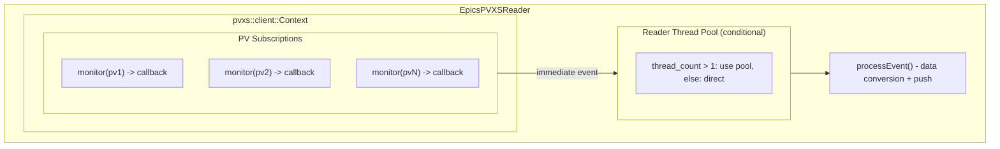

# EpicsPVXSReader (Event-Driven)

The `EpicsPVXSReader` provides modern EPICS PVAccess monitoring using an event-driven subscription model. It uses the PVXS client library for direct PV access with immediate event callbacks.

**Registration Type:** `"epics-pvxs"`

File           | Location
-------------- | -----------------------------------------------
Header         | `include/reader/impl/epics/pvxs/EpicsPVXSReader.h`
Implementation | `src/reader/impl/epics/pvxs/EpicsPVXSReader.cpp`

## Build Option & Required Libraries

- **Build option:** none (always built)
- **Required libraries/components:**
  - PVXS (`libpvxs`)
  - EPICS Base core libs (`libCom`, `libpvData`, `libpvAccess`, `libpvaClient`, `libpvAccessCA`, `libca`)
- **Configure-time hints:** `PVXS_BASE`, `EPICS_BASE`, `EPICS_HOST_ARCH`
- **Optional link mode:** `-DMLDP_PVXS_DRIVER_LINK_EPICS_PVXS_STATIC=ON` for static EPICS/PVXS linking

## Architecture



## Data Flow

1. PVXS context establishes subscriptions via `pva_context_.monitor(pv)`
2. Subscription callbacks fire immediately on PV value changes
3. Events are dispatched to the reader thread pool (or direct if single-threaded)
4. `processEvent()` converts PVXS Value to protobuf
5. Event batch is pushed to the bus

## Configuration

```yaml
reader:
  - epics-pvxs:
      - name: my_pvxs_reader
        thread-pool: 2                # Event conversion thread pool size
        environment:                  # optional, affects only this reader's PVXS context
          EPICS_PVA_ADDR_LIST: "134.79.0.255:5076"
          EPICS_PVA_AUTO_ADDR_LIST: "NO"
          EPICS_PVA_INTF_ADDR_LIST: "10.0.0.10"
          EPICS_PVA_BROADCAST_PORT: "5076"
          EPICS_PVA_NAME_SERVERS: "nameserver.example.org:5076"
          EPICS_PVA_CONN_TMO: "42.5"
        pvs:
          - name: MY:PV:NAME
```

### Per-reader PVXS network settings

`environment:` is an optional map of PVXS client settings. The reader begins with the
process `EPICS_PVA_*` environment settings, then applies this map only while building
its own `pvxs::client::Context`. It never changes the process environment, so other
readers retain their independently configured contexts. Omit `environment:` to use
only the inherited process settings.

Any `EPICS_PVA_*` definition with a scalar string value is forwarded to PVXS. For
example, `EPICS_PVA_CONN_TMO: "42.5"` is forwarded with the five settings shown
above. Non-`EPICS_PVA_*` names, a non-map `environment:` block, and non-scalar values
are rejected during reader configuration. PVXS owns interpretation of the forwarded
definitions: unsupported names can be ignored, and malformed values follow PVXS's
logging and handling behavior.

## Key Features

- **Event-Driven**: Immediate response to PV changes (no polling overhead)
- **Smart Threading**: Conditional thread pool usage based on thread count
- **PVXS Options**: Support for custom channel options

## Conditional Parallelization

The reader implements smart thread pool decisions to avoid overhead:

```cpp
// Line 132 in EpicsPVXSReader.cpp
reader_pool_->get_thread_count() > 1 ? reader_pool_.get() : nullptr
```

- **Single thread (= 1)**: Bypass thread pool, execute directly
- **Multiple threads (> 1)**: Use thread pool for parallel conversion

## SLAC BSAS NTTables

`epics-pvxs` handles scalar and scalar-array PVs only. SLAC BSAS NTTables are read by
two dedicated readers that derive from `EpicsPVXSReader` and share its PVXS
client settings (`environment`, `thread-pool`, `metadata`):

Reader type            | Table            | Documentation
---------------------- | ---------------- | ---------------------------------------------
`epics-pvxs-bsas-gen1` | BSAS Gen1        | [SLAC BSAS NTTable Gen 1](slac-bsas-table-gen1.md)
`epics-pvxs-bsas-gen2` | BSAS Gen2        | [SLAC BSAS NTTable Gen 2](slac-bsas-table-gen2.md)

Configuring `option.type: slac-bsas-table` on an `epics-pvxs` PV is a configuration
error whose message points to `epics-pvxs-bsas-gen1`. Migration:

```yaml
# before                                  # after
reader:                                   reader:
  - epics-pvxs:                             - epics-pvxs-bsas-gen1:
      - name: r                                 - name: r
        pvs:                                      pvs-per-data-batch: 1  # was option.column-batch-size
          - name: BSA:TABLE:PV                    pvs:
            option:                                 - name: BSA:TABLE:PV
              type: slac-bsas-table
              column-batch-size: 1
```

## Use Cases

- Modern EPICS installations with PVAccess support
- High-frequency PV updates requiring minimal latency
- Applications needing immediate event notification
- Systems with NTTable data structures
